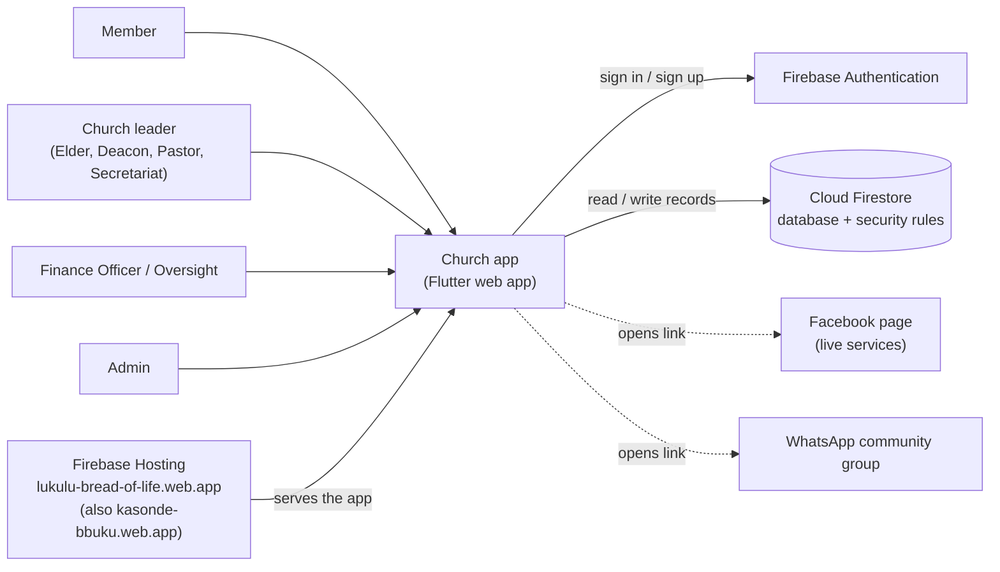
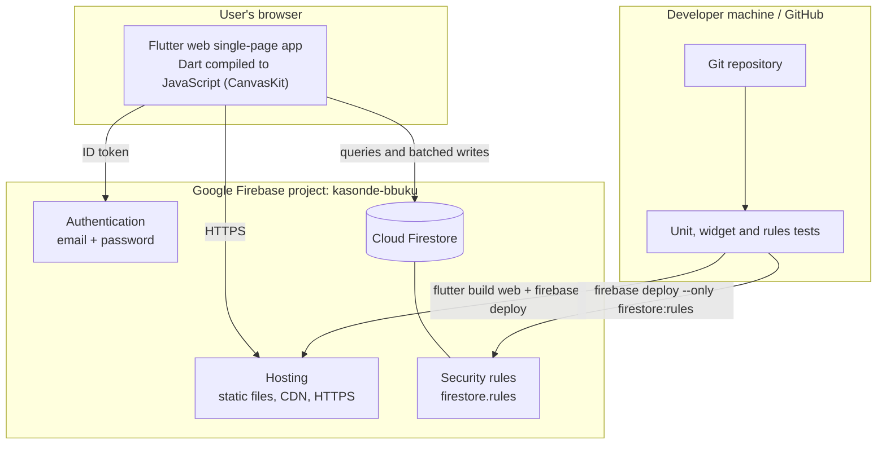
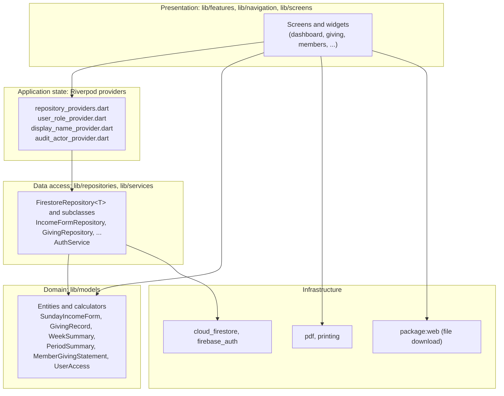
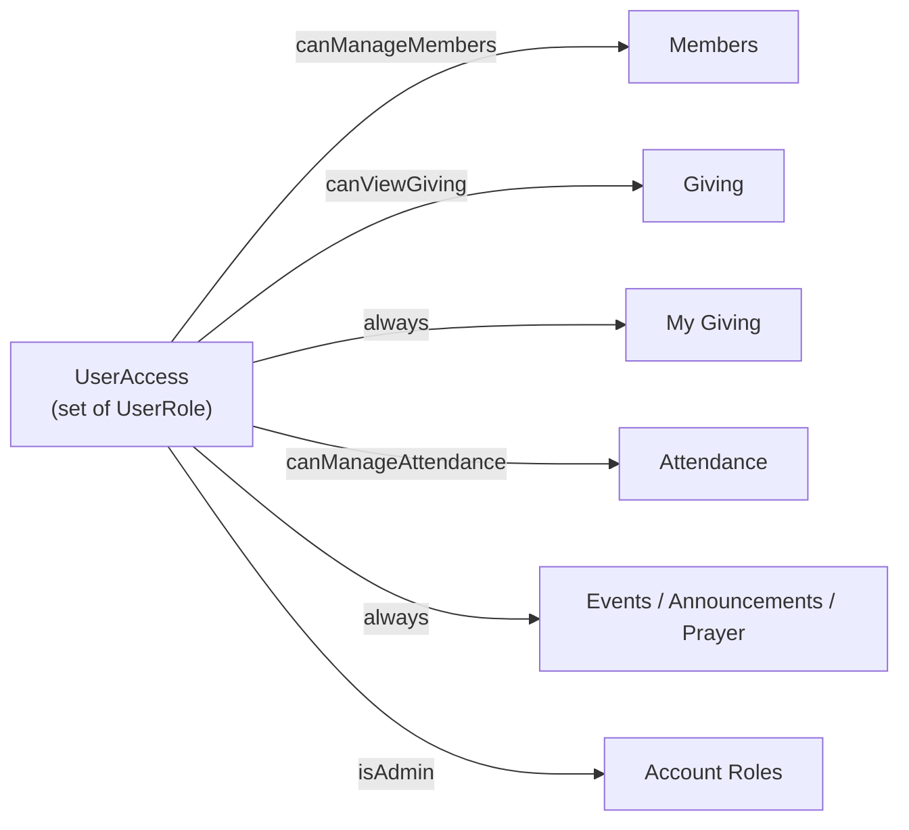
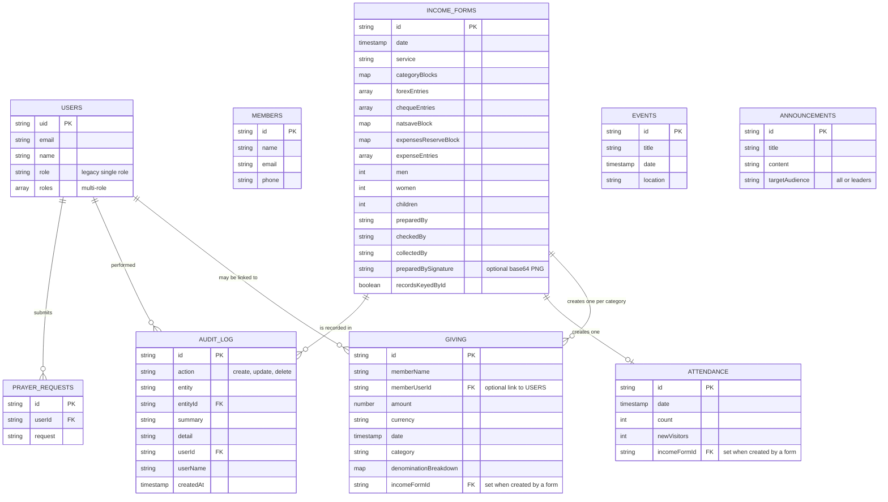
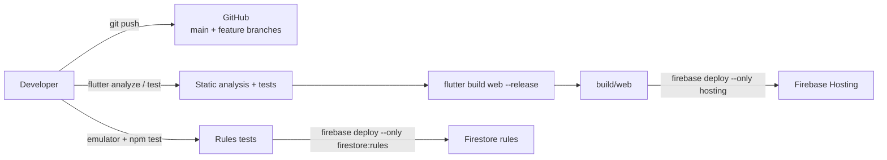

# Architecture

## 1. System context

Who uses the system and what it depends on.



## 2. Containers



All business logic runs **in the browser**; there is no custom server. The
database is therefore protected by **security rules**, which are the real
enforcement point for who may read or write what (the app hiding a button is
convenience, not security).

## 3. Layered structure of the app



**Rules of the structure**

- Screens depend on providers and models, never on Firestore directly.
- Repositories convert between Firestore documents and model objects.
- Models hold the business rules and calculations as plain Dart (no Flutter or
  Firebase imports for the calculators), so they are cheap to unit-test.

## 4. Source tree

```
lib/
  main.dart                  App entry: Firebase init, auth gate
  core/
    constants/               Firestore collection names, links, daily verses
    providers/               Cross-cutting providers (auth, role, name, download)
    repositories/            FirestoreRepository<T> base class
    theme/                   AppColors, AppTheme (purple / gold / blue)
    utils/                   Date, currency, CSV, greeting, file download
    widgets/                 Shared UI (empty state, async view, role badge)
  models/                    Domain entities and calculators
  repositories/              One repository per collection + providers
  services/                  AuthService
  navigation/                AppShell, AppSidebar, role-based destinations
  features/
    dashboard/ giving/ members/ attendance/ events/ announcements/ prayer/
  screens/                   AuthScreen
test/                        Unit and widget tests
rules-tests/                 Firestore security-rule tests (emulator)
firestore.rules              Server-side authorisation
firebase.json                Hosting + emulator configuration
docs/                        This documentation
```

## 5. Navigation and role-based access

`AppShell` asks `userRoleProvider` for the signed-in user's `UserAccess` and builds
only the destinations that role may use. Wide screens (900 px and up) show
`AppSidebar`; narrow screens show a bottom bar with the first four items and a
**More** tab.



A user may hold several roles; each capability is true if **any** held role grants it.
Legacy accounts with a single `role` field still work (`UserAccess.fromData`).

## 6. Data model (Firestore)



**Derived-record keys.** A form's records use predictable ids so an edit or delete
can address exactly them: `<formId>_<category>` for giving and
`<formId>_attendance` for attendance. Forms saved before this scheme
(`recordsKeyedById` false) are read-only.

**Derived values are never stored.** Totals, the 20% tithe remittance, Natsave
deposit, reconciliation variance, attendance total and so on are computed from
the stored counts each time, so they cannot disagree with the source data.

## 7. Security architecture

| Concern | Mechanism |
|---|---|
| Authentication | Firebase Auth (email + password). Passwords never touch the app's own code beyond the SDK call. |
| Authorisation | `firestore.rules` mirrors the permission getters in `user_role_provider.dart` ("keep in sync"). Each collection has its own rule. |
| Privilege escalation | Self-signup may only create `role: member`; only an Admin may change roles, and not remove their own admin. |
| Financial confidentiality | `giving` and `income_forms` readable only by Admin, Finance, Oversight and Pastor (read-only for the last two); a member may read only giving linked to their own uid. |
| Separation of duties | A sign-up may record a `requestedRole` on the new profile, which grants nothing until an Admin approves it. Oversight and Pastor are read-only. An Admin creates staff accounts on a short-lived second Firebase app, so the Admin stays signed in and never sees the temporary password; roles are then granted through the Admin-only update rule. Finance can maintain only attendance records created by a form. A member can edit, mark answered or delete only their own prayer requests; leaders moderate all. |
| Integrity of changes | Each form create/edit/delete and its activity-log entry commit in **one atomic batch**. `audit_log` is write-once: no update or delete for anyone. |
| Spreadsheet safety | The CSV writer neutralises formula-like text (`=`, `+`, `-`, `@`). |
| Transport / headers | HTTPS (Firebase Hosting). `X-Content-Type-Options`, `X-Frame-Options: DENY`, `Referrer-Policy`, and revalidating `Cache-Control`. |
| Public config | The Firebase web API key is public by design; protection comes from the rules above. |

The rules are covered by **70** emulator tests in `rules-tests/rules.test.mjs`
(allowed and forbidden operations for each role).

## 8. Deployment



**Release checklist**

1. `flutter analyze` and `flutter test` pass; rules tests pass if rules changed.
2. If rules changed: **deploy the rules first** (a new app version may write
   documents the old rules refuse).
3. `flutter build web --release`, then `firebase deploy --only hosting`.
4. Open the live site and confirm the login page loads.

Branching: one `feature/...` branch per module, task-based commits, merged to
`main` when verified. (A Vercel configuration exists on `feature/vercel-hosting`
as an alternative host.)

## 9. Cross-cutting design decisions

| Decision | Reason |
|---|---|
| Riverpod providers as the single source of state | Streams from Firestore update every screen live; trivial to override in tests. |
| Generic `FirestoreRepository<T>` | One tested implementation of list/add/update/delete; subclasses only map documents. |
| Atomic `WriteBatch` for multi-document changes | A form, its giving and attendance records and its audit entry succeed or fail together. |
| Calculators as pure Dart (`WeekSummary`, `PeriodSummary`, ...) | Money logic is tested without Flutter or a database. |
| PDF with built-in Helvetica (ASCII only) | Avoids shipping a font; a test guards against characters it cannot draw. |
| Conditional import for file download | Web gets a real download; other platforms fail clearly. |
| Static single-page app, no custom server | Simplest and cheapest hosting; all data access still passes through the security rules. |

## 10. Quality attributes

| Attribute | How it is addressed |
|---|---|
| **Correctness of money** | Derived values only; unit tests replicate the real paper form's figures (2900 tithe, 580 remittance, 3760-3180 reserve). |
| **Security** | Server-side rules, immutable audit log, role separation, tested. |
| **Auditability** | Who/what/when for every form change, with before/after totals. |
| **Usability** | Live totals while typing, reconciliation warning, role-tailored navigation, responsive layout. |
| **Reliability** | Atomic multi-document writes; print falls back to download. |
| **Maintainability** | Layered structure, small reusable widgets, 75+ automated app tests plus 70 rules tests, documentation. |
| **Portability** | Web today; the model/repository layers are platform-neutral. |

## 11. Testing strategy

| Level | Tool | Examples |
|---|---|---|
| Unit | `flutter_test` | Totals, reconciliation, period roll-ups, CSV escaping, role merging |
| Widget | `flutter_test` + provider overrides | Dashboard layouts at 3 sizes, edit/delete visibility, signature pad drawing, auth form |
| Security rules | `@firebase/rules-unit-testing` on the Firestore emulator | Every role against every collection, atomic batches |
| Static analysis | `flutter analyze` | Zero issues required |
| Manual | Browser | Print dialog, real-device signatures |

## 12. Known limitations and technical debt

- `userRoleProvider` and `userProfileNameProvider` read Firestore directly rather than via a repository.
- `SundayIncomeFormScreen` is large and mixes form state, calculation and presentation; extracting a form controller would raise cohesion.
- Forms saved before the keyed-record scheme are read-only (no migration yet).
- No push notifications; no offline mode beyond what Firestore caching gives.
- The audit log covers Sunday Income Forms only, not individual giving, members or roles.
