# Sequence Diagrams

Each diagram shows who calls whom, in order. Participant names match the code
(`file.dart` in brackets where helpful).

---

## 1. Sign in and resolve the user's role

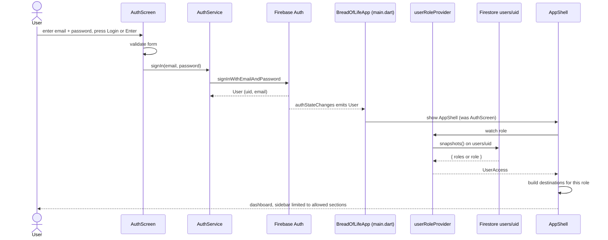

---

## 2. Sign up (always creates a Member)

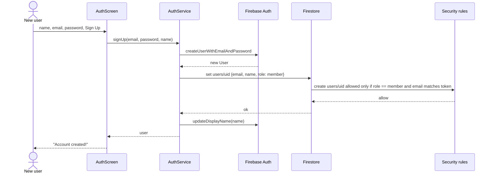

An attempt to sign up with `role: admin` is refused by the rules (tested).

---

## 3. Forgot password

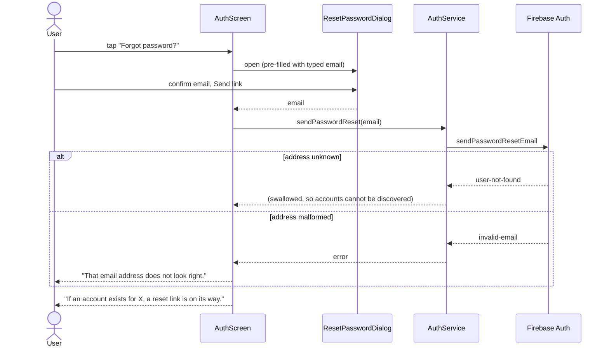

---

## 4. Save a Sunday Income Form (atomic cascade + audit)

The central business transaction. One batch writes the form, its giving records,
its attendance record and the audit entry - all or nothing.

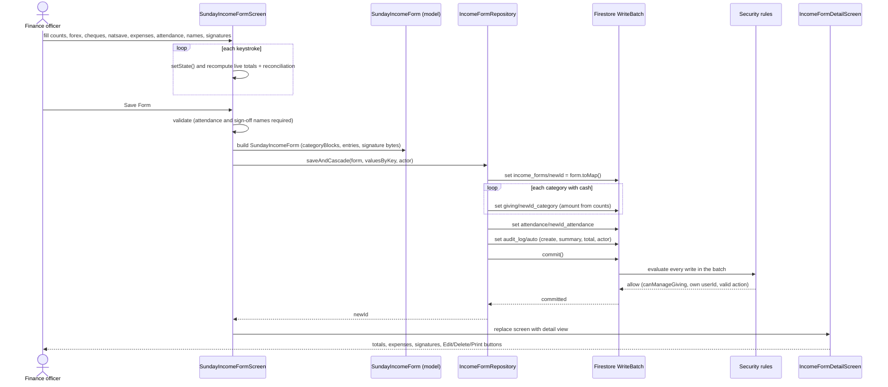

If any single write is refused or the network fails, **nothing** is saved.

---

## 5. Edit a saved form

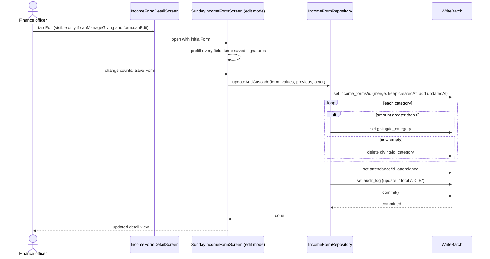

---

## 6. Delete a saved form

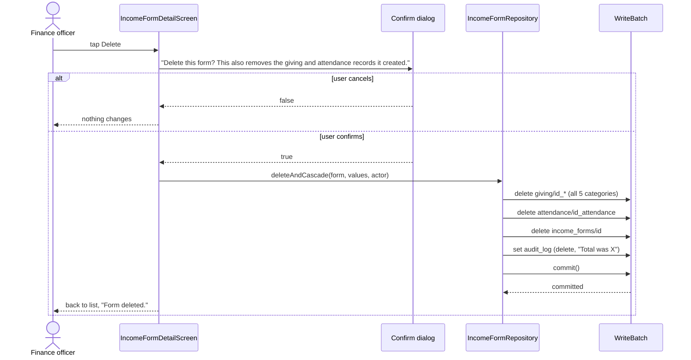

The audit entry survives the deletion, nobody can edit or remove it.

---

## 7. Print or download a PDF (with fallback)

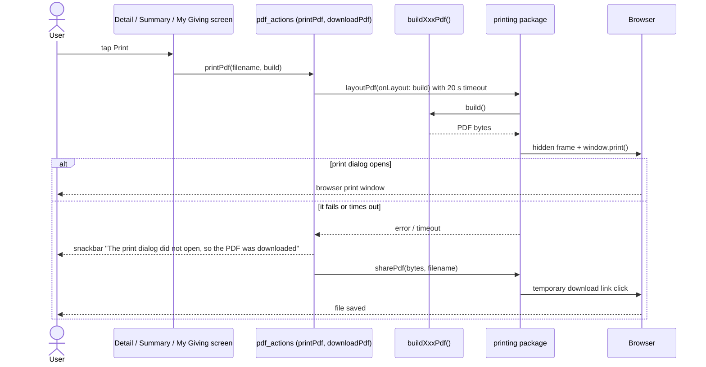

---

## 8. Draw a signature

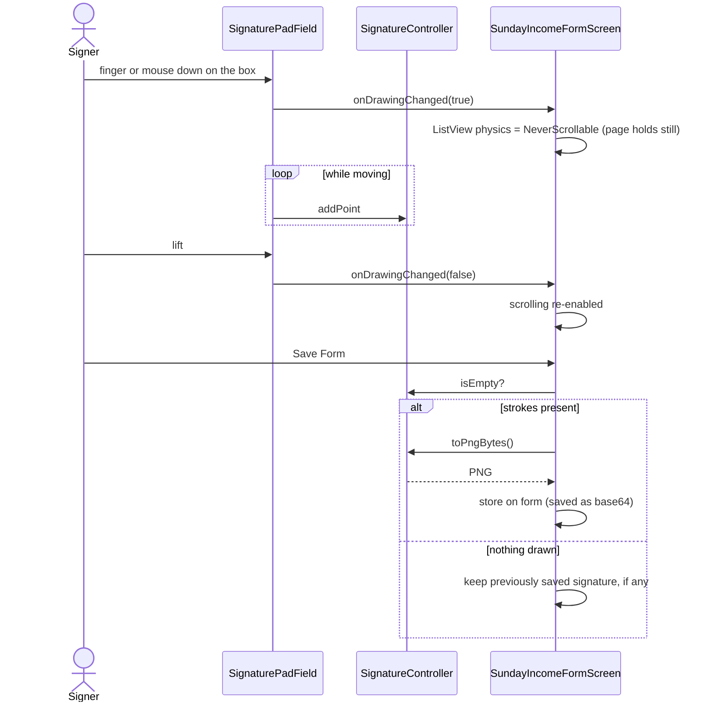

---

## 9. Monthly or yearly summary

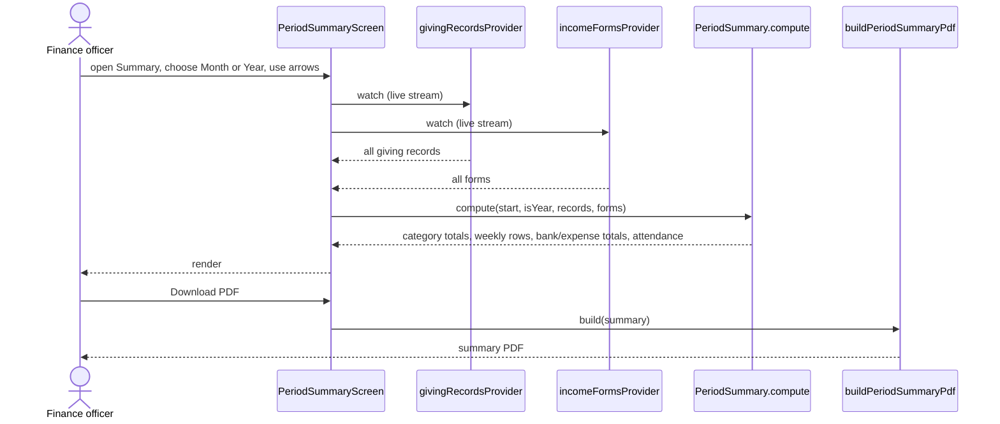

---

## 10. Export to CSV

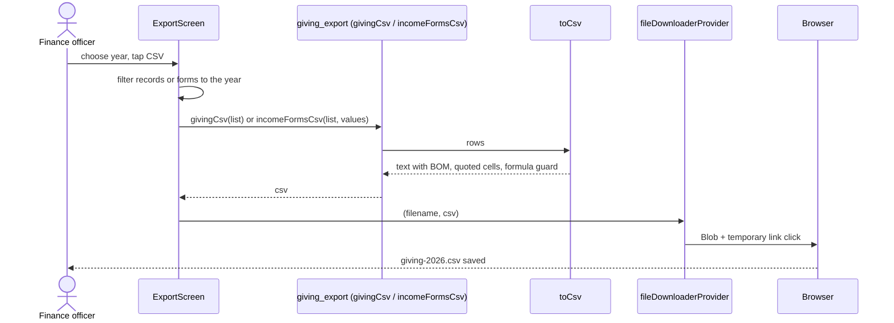

---

## 11. A forbidden action is refused by the server

Hiding buttons is not security. This shows the real barrier.

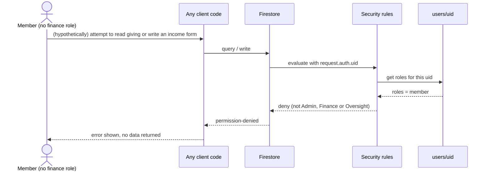

---

## 12. Live totals while typing (reconciliation)

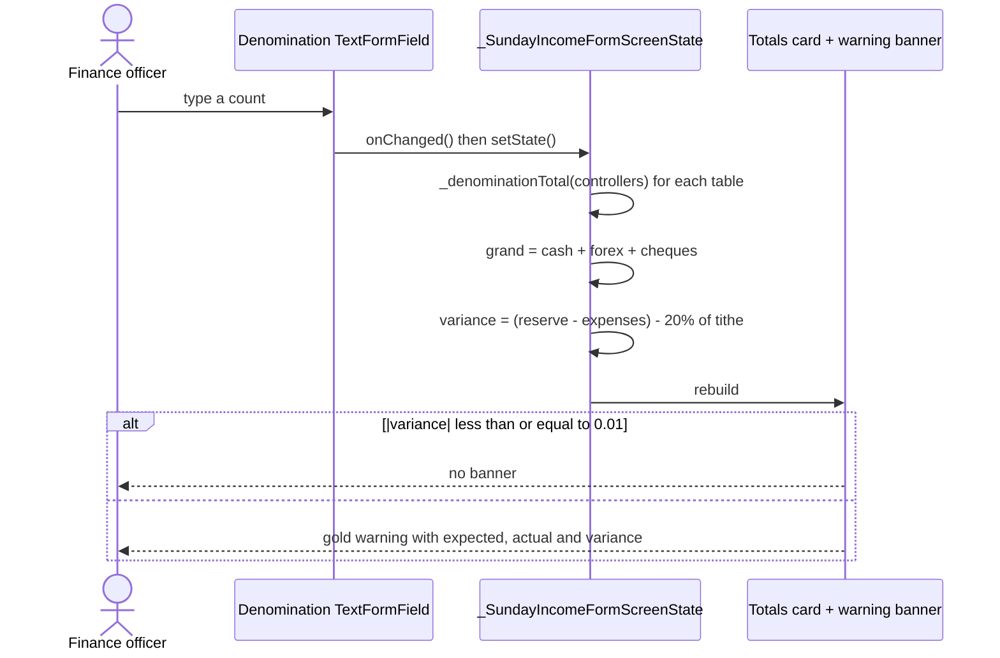
