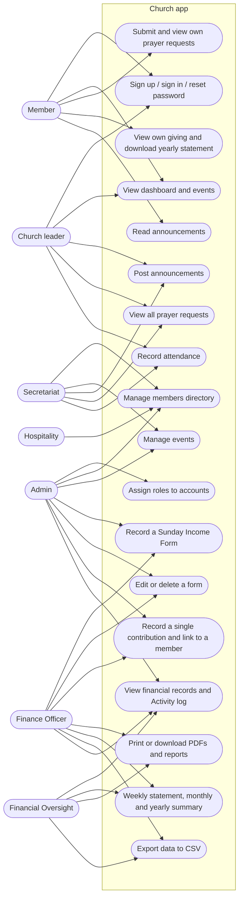
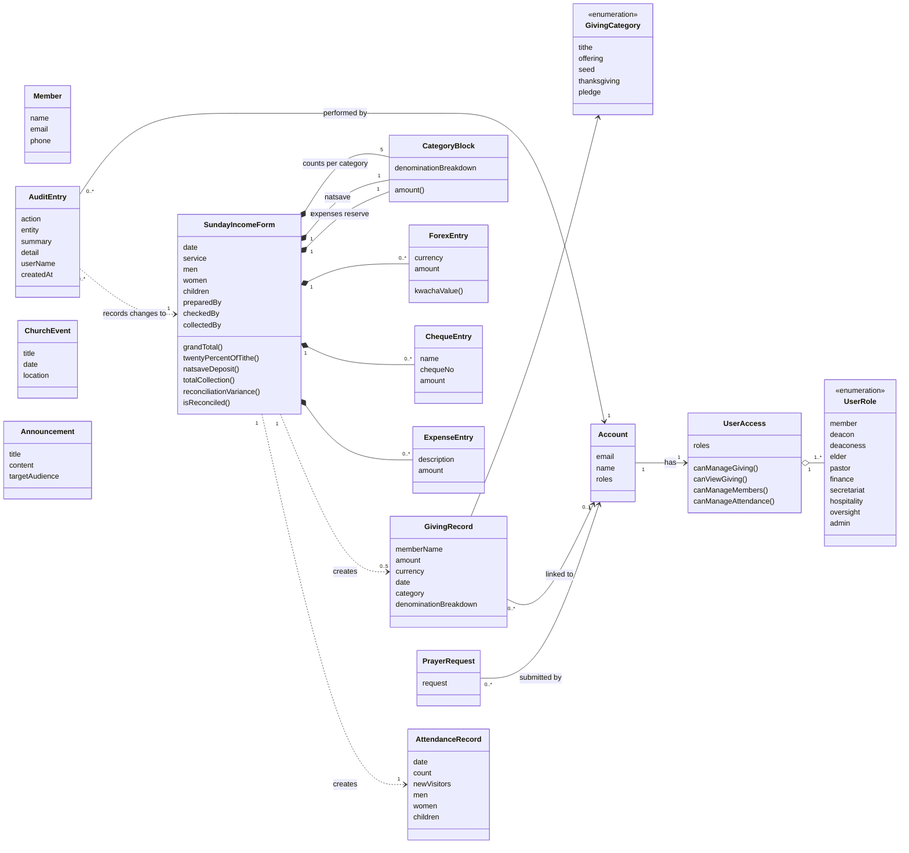
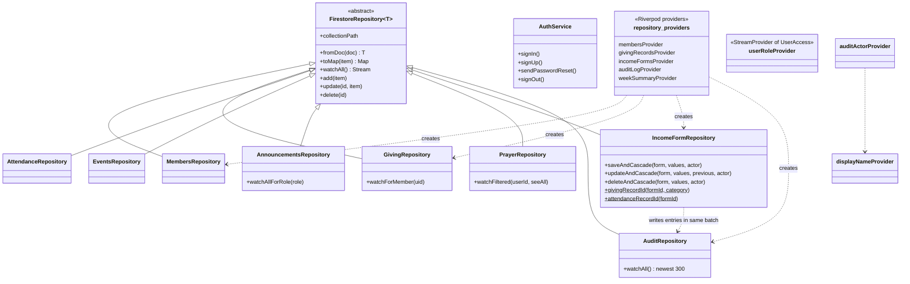
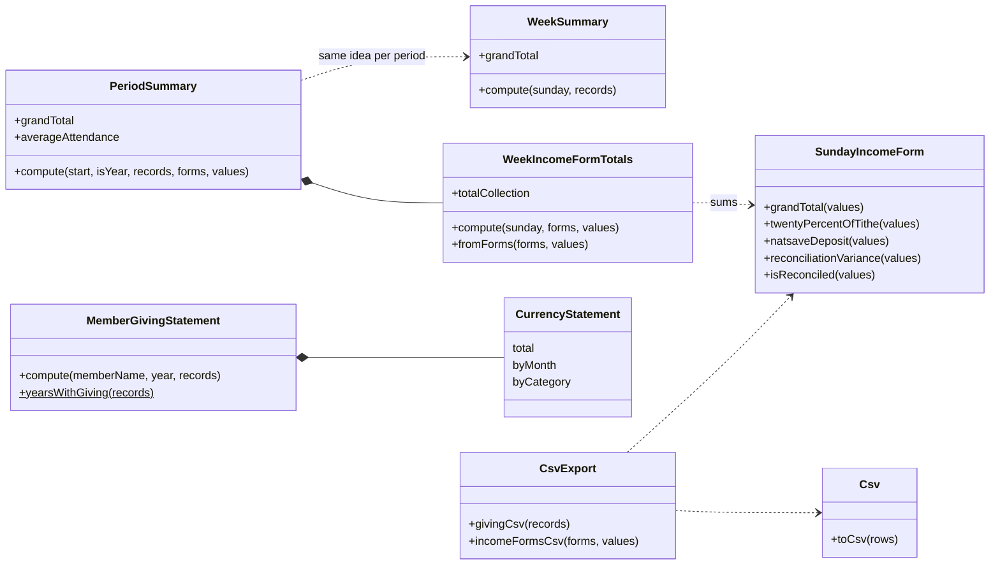
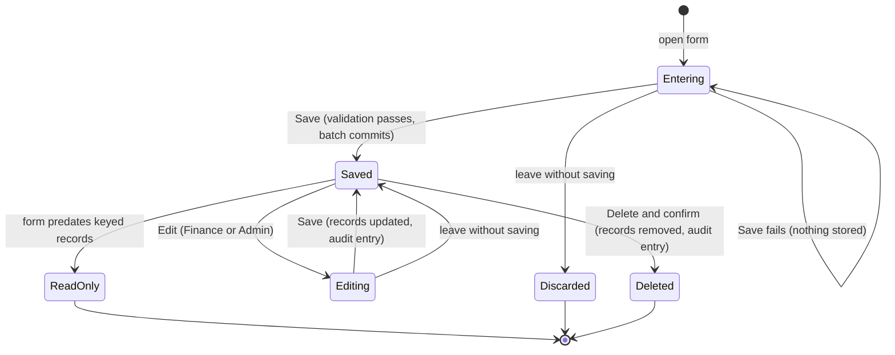
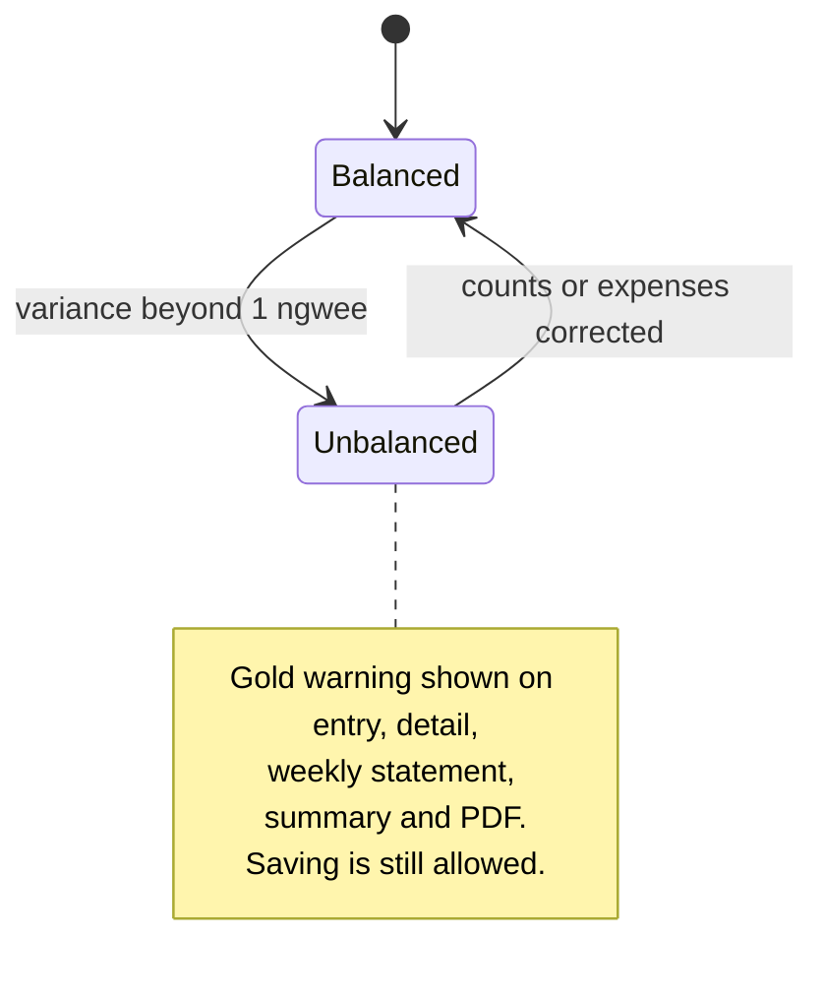
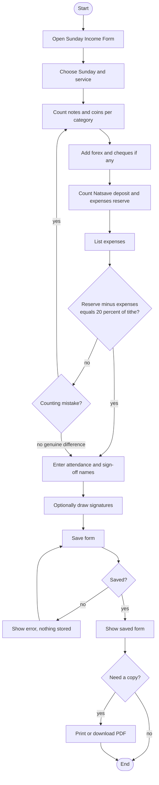
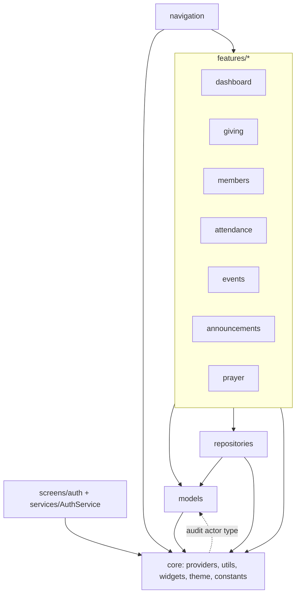

# UML

Models of the system from the requirements side (use cases, domain model) to the
design side (classes, states, activities).

## 1. Use cases

Notes: every actor can also do the Member use cases. Admin can do everything the
Finance Officer can (use cases 11-17 above). Oversight is **read-only** (it sees
reports and the log but has no create, edit or delete). Hospitality manages only the
members directory.

### Use case: Record a Sunday Income Form (fully dressed)

| | |
|---|---|
| **Primary actor** | Finance Officer (or Admin) |
| **Stakeholders** | Pastor (needs an accurate filed copy); Congregation (trust); Auditors |
| **Preconditions** | Actor is signed in with the Finance or Admin role |
| **Trigger** | Cash from a service has been counted |
| **Main success scenario** | 1. Open Giving, choose Sunday Income Form. 2. Pick the Sunday and service. 3. Enter note/coin counts per category. 4. Enter forex and cheques. 5. Enter Natsave and expenses-reserve counts and the expenses list. 6. Enter attendance and sign-off names; optionally draw signatures. 7. System shows live totals and reconciliation status. 8. Actor saves. 9. System atomically stores the form, one giving record per category, one attendance record and an audit entry. 10. System shows the saved form. |
| **Extensions** | 7a. Reserve minus expenses is not 20% of tithe: warning shown; actor may correct or save anyway. 8a. Required field missing: save is blocked with a message. 9a. Write refused or network fails: nothing is saved, error shown. |
| **Postconditions** | Form, derived records and audit entry exist, or none do |
| **Special requirements** | Amounts derived from counts; ASCII-safe PDF; works on phone and desktop |

## 2. Domain model (conceptual)

## 3. Design class diagram: data access and state

## 4. Design class diagram: calculators

Pure Dart classes that turn stored facts into figures. None of them touches Flutter
or Firebase.

## 5. State diagram: life of a Sunday Income Form

### Reconciliation state (inside Entering, Editing and Saved)

## 6. Activity diagram: filling in the form

## 7. Package / component view

Dependencies point downward almost everywhere, which keeps business rules reusable
and testable. There is one small upward link: `core/providers/audit_actor_provider.dart`
imports the `AuditActor` type from `models`, while `models` use `core/utils` helpers
(a mild cycle between two low-level packages; moving `AuditActor` into `core` would
remove it).
